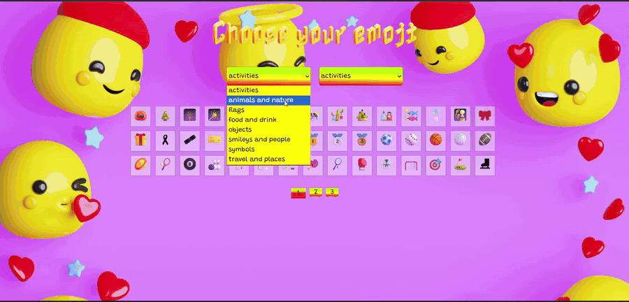
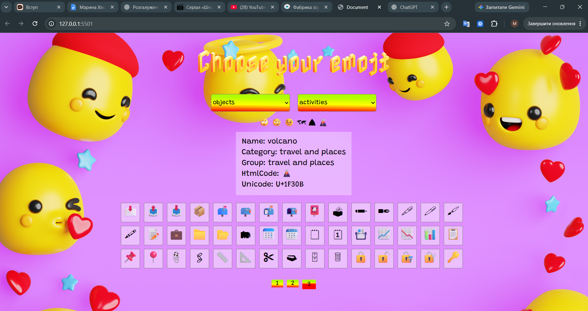

# 🎨 Emoji Explorer

**A colorful, interactive emoji browser built with HTML, CSS, and vanilla JavaScript.**

Explore emojis by category or group, browse pages of results, and click an emoji to view its details.

## 🎬 Live Preview



*Watch the emoji browser in action — explore categories, switch groups, and browse pages.*

## 📸 Screenshot



## ✨ Features

- 🌐 Fetches emoji data from the [EmojiHub API](https://emojihub.yurace.pro/)
- 🔎 Browses emojis by **category** and **group**
- 📄 Displays up to **45 emojis per page**
- 🖱️ Shows each emoji's **name, category, group, HTML code, and Unicode** on selection
- 🎨 Colorful custom interface with Google Fonts
- ⚡ Dynamically renders results using JavaScript and DOM manipulation

## 🛠️ Tech Stack

- **HTML5** — page structure
- **CSS3** — custom styling and layout
- **JavaScript (ES6+)** — API requests, filtering, rendering, event handling, and pagination
- **Fetch API** — loading data from EmojiHub

## 🚀 Getting Started

1. Clone the repository:

   ```bash
   git clone https://github.com/marinenok2/emoji-explorer.git
   ```

2. Open the project folder in VS Code.
3. Run `index.html` with the **Live Server** extension, or open it in a browser.
4. Use the dropdown menus to browse emojis and click an emoji to see its details.

> **Important:** The current HTML references `CSS/style.css`, `CSS/normalize.css`, and `JS/script.js`, while the stylesheet references `image/9430268.jpg`. Keep those paths and files in your repository, or update the links to match your actual folders. The app also needs an internet connection to load emojis from the API.

## 📁 Project Structure

Example structure matching the paths used in `index.html` and `style.css`:

```text
emoji-explorer/
├── index.html
├── CSS/
│   ├── style.css
│   └── normalize.css
├── JS/
│   └── script.js
├── image/
│   └── 9430268.jpg
├── assets/
│   ├── screenshot.png
│   └── emoji-explorer-demo.gif
└── README.md
```

## 📚 What I Practiced

This project helped me practice working with external APIs, asynchronous JavaScript, data grouping, DOM manipulation, event listeners, and pagination.

## 👩‍💻 Author

**Maryna Khvoinytska**

- [GitHub](https://github.com/marinenok2)
- [LinkedIn](https://www.linkedin.com/in/maryna-khvoinytska-43870019a/)

---

*Built as a frontend learning project.*
